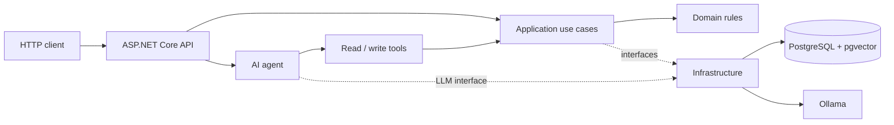

# ITSM AI Agent

An API-first IT Service Management (ITSM) project combining **ASP.NET Core**, a local **LLM agent**, and **Retrieval-Augmented Generation (RAG)**. The agent can inspect incidents, search internal troubleshooting guides, and propose changes that require human approval.

## Features

- **ITSM API:** requesters, incidents, status changes, comments, and filtering.
- **AI agent:** Qwen3 running locally via Ollama, with tool calling and a bounded execution loop.
- **Human-in-the-loop:** AI-initiated write actions through the agent chat require approval; reads run automatically.
- **RAG:** document ingestion, chunking, embeddings, and semantic search with PostgreSQL/pgvector.
- **Observability:** persisted agent runs, tool executions, and approval decisions.
- **Quality checks:** xUnit tests and a live LLM tool-selection evaluation suite.

## Tech stack

**.NET 10 / C#** · ASP.NET Core Web API · EF Core · PostgreSQL + pgvector · Ollama (`qwen3:8b`, `embeddinggemma`) · xUnit

## Architecture



The solution separates **Domain**, **Application**, **Infrastructure**, **API**, and **Agent** responsibilities.

## Run locally

**Requirements:** .NET 10 SDK, Docker, Ollama, and the `dotnet-ef` CLI tool.

From the repository root:

```bash
docker compose up -d
ollama pull qwen3:8b
ollama pull embeddinggemma

dotnet restore
dotnet ef database update --project ItsmAi.Infrastructure --startup-project ItsmAi.Api
dotnet run --project ItsmAi.Api
```

Keep Ollama running. Local configuration is in `ItsmAi.Api/appsettings.Development.json`; the included PostgreSQL credentials are **development-only**. The API address is printed on startup. In Development, the OpenAPI specification is available at `/openapi/v1.json`.

## Try it

First add a knowledge document with `POST /api/knowledge/documents`, then ask the agent:

**`POST /api/agent/chat`**

```json
{
  "message": "How should I troubleshoot a user who cannot connect to the corporate VPN? Use our knowledge base."
}
```

## API endpoints

| Method | Endpoint | Request model | Description |
|---|---|---|---|
| `POST` | `/api/requesters` | `CreateRequesterRequest` | Create a requester |
| `POST` | `/api/incidents` | `CreateIncidentRequest` | Create an incident |
| `GET` | `/api/incidents` | Query: `status`, `priority`, `page`, `pageSize` | List and filter incidents |
| `GET` | `/api/incidents/{id}` | Path: `id` (UUID) | Get incident details and comments |
| `PATCH` | `/api/incidents/{id}/status` | `ChangeIncidentStatusRequest` | Change incident status |
| `POST` | `/api/incidents/{id}/comments` | `AddIncidentCommentRequest` | Add a support comment |
| `POST` | `/api/knowledge/documents` | `CreateKnowledgeDocumentRequest` | Ingest and index a document |
| `POST` | `/api/knowledge/search` | `SearchKnowledgeRequest` | Semantic knowledge search |
| `POST` | `/api/agent/chat` | `AgentChatRequest` | Chat with the AI agent |
| `GET` | `/api/agent/approvals/{approvalId}` | Path: `approvalId` (UUID) | Get an approval request |
| `POST` | `/api/agent/approvals/{approvalId}/approve` | No body | Approve a proposed write action |
| `POST` | `/api/agent/approvals/{approvalId}/reject` | No body | Reject a proposed write action |

### Request bodies

| Model | Example JSON body |
|---|---|
| `CreateRequesterRequest` | `{"name":"Jane Doe","email":"jane@example.com"}` |
| `CreateIncidentRequest` | `{"requesterId":"<requester-uuid>","title":"VPN issue","description":"Cannot connect to VPN","priority":"High"}` |
| `ChangeIncidentStatusRequest` | `{"status":"InProgress"}` |
| `AddIncidentCommentRequest` | `{"content":"Investigating the issue."}` |
| `CreateKnowledgeDocumentRequest` | `{"title":"VPN guide","content":"Check connectivity and VPN credentials."}` |
| `SearchKnowledgeRequest` | `{"query":"VPN connection problem","limit":3}` |
| `AgentChatRequest` | `{"message":"How do I troubleshoot VPN?"}` |

**Enums:** 
`priority` = `Low`, `Medium`, `High`, `Critical`; 
`status` = `New`, `InProgress`, `Resolved`, `Closed`. 

## Tests & evaluations

```bash
dotnet test
```

The evaluation uses a running Ollama instance and checks which tool the model selects:

```bash
cd ItsmAi.Evals
dotnet run
```
